All the cool kids may be using CSS Grid now, but there are still plenty of scenarios where Flexbox does exactly what you need. This article will give an introductory look at what you can do with Flexbox.

## What is Flexbox?

Flexbox is the more commonly used name for the [CSS Flexible Box Layout Module](https://www.w3.org/TR/css-flexbox-1/). It has very wide browser support. According to [CanIUse.com](https://caniuse.com/flexbox), it is fully supported in all modern browsers. It even has pretty decent support in IE11, though it can be buggy.

Flexbox is a one-dimensional layout. The _flex items_ inside a _flex container_ are laid out either in a horizontal row or a vertical column. There are several CSS properties that are used to fine-tune flexbox behavior when it comes to placement, sizing, and alignment.

## Concepts

A quick note on concepts: I will describe the flow of flex layouts from left to right and top to bottom. This is usually how it works, but some locales flow text from right to left and so the default direction will be different. Make sure to keep this in mind when learning these concepts.

### Main axis

The _main axis_ is the direction of the flex container. In a row flexbox container, the main axis is the horizontal axis, along the direction that the flex items are placed.

### Cross axis

The _cross axis_ is the direction perpendicular to the direction of the flex container. In a row flexbox container, the cross axis is the vertical axis.

## Creating a flexbox layout

It's very easy to create a flexbox layout. Just set an element's `display` property to `flex`. This will make the element a flex container. Any direct children will become flex items and will be laid out along the main axis.

To specify whether the flex container should be a row or column, set the `flex-direction` property to `row` or `column`, respectively.

The flex items will be flush against each other - by default, there is no spacing between them. Space can be added in two ways. The first, more widely supported way, is to just add `margin` to the flex items. There is another way to set uniform spacing of all flex items, by using the `gap` property. However, the `gap` property is only currently supported for flexbox in [a few browsers](https://caniuse.com/flexbox-gap).

Let's create a quick flex container. Here's the HTML:

```html
<div class="container">
  <div class="item">1</div>
  <div class="item">2</div>
  <div class="item">3</div>
  <div class="item">4</div>
</div>
```

And the accompanying CSS:

```css
.container {
  background: lightgray;
  display: flex;
  flex-direction: row;
  width: 20rem;
  border: 1px solid black;
}

.item {
  background: skyblue;
  font-size: 3rem;
  width: 3rem;
  border: 1px solid red;
  text-align: center;
}
```

Here's the result:

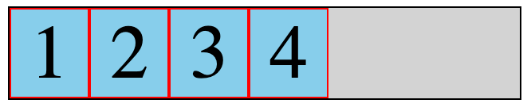

You'll notice that the flex items are bunched together at the beginning of the main axis within the flex container.

## `flex-grow`

There are a few things we can do to change this behavior. First, we can specify a value for the `flex-grow` property on a flex item. When `flex-grow` is set, the item will grow to fill available space. The value is relative to the `flex-grow` value of other flex items.

If `flex-grow` is set to 1 across all items, they will grow equally:

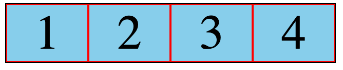

If we set `flex-grow` to 1 across all items but set it to `2` for one of the items, that item will grow twice as much as the other items:

```css
.item {
  flex-grow: 1;
}

.item2 {
  flex-grow: 2;
}
```

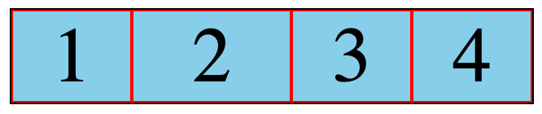

As you can see in the screenshot above, item 2 grows more than the other items. Twice as much, to be precise.

## The `justify-content` property

The `justify-content` property is set on the flex container. It specifies how the flex items are laid out along the main axis. The default value for this property is `flex-start`; it results in the behavior we've already seen. The flex items are bunched together at the beginning of the main axis.

There are several other useful values we can set for `justify-content`:

### `center`

The flex items are bunched together at the center of the main axis.

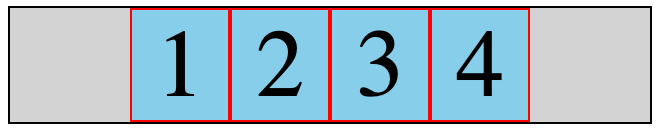

### `flex-end`

The flex items are bunched together at the end of the main axis.

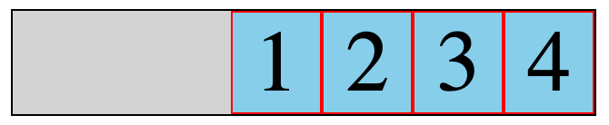

### `space-between`

The first flex item is flush with the beginning of the main axis, the last item is flush with the end of the main axis, and the remaining items are spaced evenly between them.

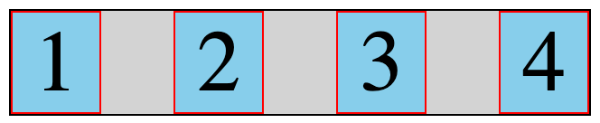

### `space-around`

An equal amount of space is used between each flex item. On the inner flex items, this space "doubles up".

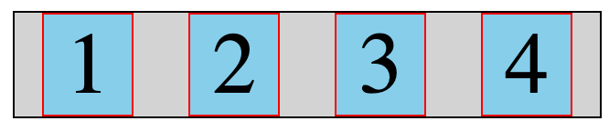

### `space-evenly`

Equal spacing is used between all flex items.

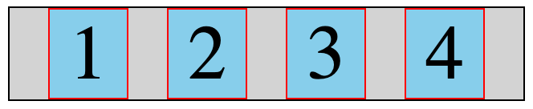

## The `align-items` property

`align-items` is similar to `justify-content`, except it specifies how items are aligned along the _cross axis_ of the flex container.

### `flex-start`

The flex items are aligned to the start of the cross axis.

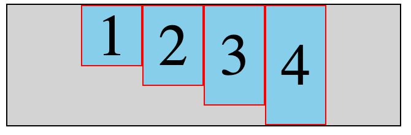

### `flex-end`

The flex items are aligned to the end of the cross axis.

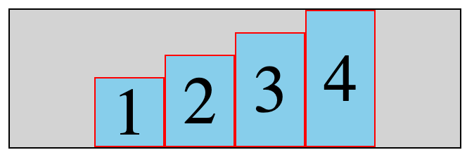

### `center`

The flex items are centered along the cross axis.

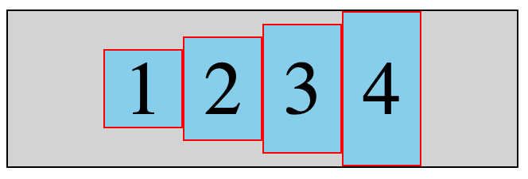

## The holy grail: Absolute centering with flexbox

The old joke of "How do you center a div?" is finally solved with flexbox. Simply set its container to be a flex container, and set both the `align-items` and `justify-content` properties to `center`:

```html
<div class="container">
  <div class="item">Item</div>
</div>
```

```css
.container {
  background: lightgray;
  display: flex;
  flex-direction: row;
  width: 20rem;
  border: 1px solid black;
  height: 20rem;
  align-items: center;
  justify-content: center;
}

.item {
  background: skyblue;
  font-size: 3rem;
  width: 8rem;
  border: 1px solid red;
  text-align: center;
}
```

The `item` div is centered horizontally and vertically inside its container:

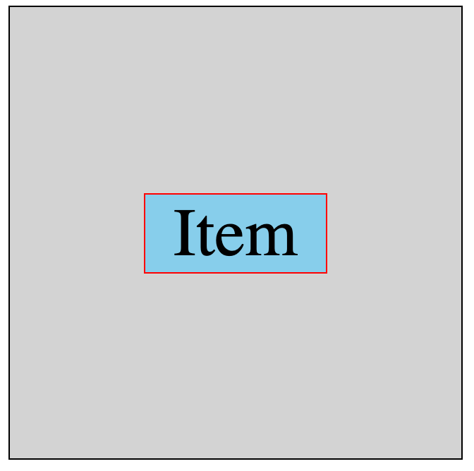

## Further learning

The best resource you'll ever find for flexbox is [A Complete Guide to Flexbox](https://css-tricks.com/snippets/css/a-guide-to-flexbox/) on CSS-Tricks. You'll find the properties we covered in this article along with many others to better tweak your flexbox layouts!

I hope you found this introduction to flexbox helpful.
