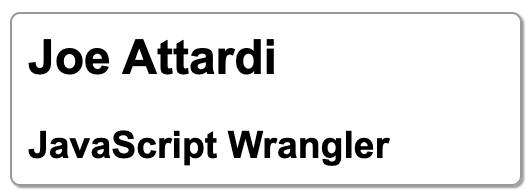
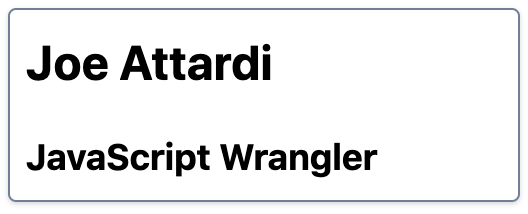

There's been a lot of buzz lately about Tailwind CSS. Maybe you're curious about it but haven't taken a look yet. This article is for you!

## Utility-first CSS

With traditional CSS, you define rules for different elements on your page. Each rule likely contains multiple CSS properties that will be applied to the element(s) matching the selector. Such a selector might use a class `profile-card` or `header-link`.

Tailwind is a utility-first CSS framework, and takes a different approach. Tailwind comes with many utility classes. Each class typically only applies a single CSS property. These classes provide building blocks with which you can create the desired style for each element.

There are many such utility classes. For example, there is a set of utility classes for border width: `border`, `border-2`, `border-4`, `border-8`, etc. Each class corresponds to an increasingly larger border width.

## A simple example

Let's look at a simple example that illustrates the different approach taken by Tailwind CSS. Here's a simplified "profile card" element:

### HTML

```html
<div class="profile-card">
  <h2>Joe Attardi</h2>
  <h3>JavaScript Wrangler</h3>
</div>
```

### CSS

```css
.profile-card {
  font-family: Arial, sans-serif;
  border: 1px solid #999999;
  width: 16rem;
  padding: 0.5rem;
  border-radius: 5px;
  box-shadow: 1px 1px 1px #999999;
  box-sizing: border-box;
}

.profile-card h2 {
  margin: 0;
}

.profile-card h3 {
  margin-bottom: 0;
}
```

The result will look something like this:



Now we'll make the same profile card using Tailwind.

### HTML

```html
<div class="w-64 rounded border border-gray-600 p-2 shadow">
  <h2 class="text-2xl font-bold">Joe Attardi</h2>
  <h3 class="mt-4 text-lg font-bold">JavaScript Wrangler</h3>
</div>
```

With Tailwind, there is no CSS for us to actually write. We just use the provided utility classes. The result looks very similar:



Here is an explanation of some of the utility classes that were used in the above HTML:

- `border` sets a `border-width` of `1px`.
- `border-gray-600` sets the border color with a color from Tailwind's built-in palette.
- `rounded` sets a `border-radius` of `0.25rem`.
- `w-64` sets a `width` of `16rem`.
- `shadow` sets a `box-shadow`.
- `p-2` sets a `padding` of `0.5rem`.
- `text-2xl` sets a `font-size` of `1.5rem`.
- `text-lg` sets a `font-size` of `1.125rem`.
- `font-bold` sets a `font-weight` of `bold`.
- `mt-4` sets a `margin-top` of `1rem`.

## Controlling the bundle size

Tailwind is typically used with a tool like [PostCSS](https://postcss.org/). Tailwind CSS is provided as a PostCSS plugin.

If you take a look at the [Tailwind documentation](https://tailwindcss.com/docs), you will see that there are a _lot_ of utility classes. There are multiple classes defined for each possible value of each supported CSS property. As you might imagine, this can result in a very large CSS file. And the size would be wasted, as the vast majority of the utility classes aren't even used.

To address this, Tailwind uses PurgeCSS under the hood. It looks at your HTML to figure out which of its utility classes you are using, and removes the unused classes from the resulting bundle.

If you dynamically set class names in JavaScript, either with vanilla JavaScript or a library like Vue, you can also scan those source files for class names to make sure the final bundle contains all the classes you need and nothing else. You can configure which files are checked in the Tailwind configuration file:

```javascript
module.exports = {
  purge: ['./src/**/*.html', './src/**/*.vue'],
};
```

## Why use Tailwind?

So, should you use Tailwind in your next project? If you don't like writing your own CSS, then you might find Tailwind attractive. With most use cases you will need to write very little, if any, CSS of your own.

## Summary

Utility-first CSS frameworks like Tailwind take a vastly different approach to styling elements. Instead of writing a long disorganized stylesheet, you can use well defined, well documented building block classes to create the exact look and feel you need. Try it out in your next project!
