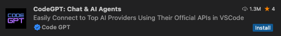
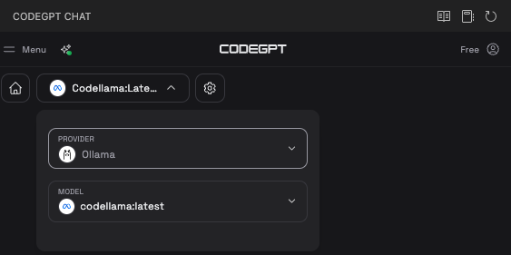
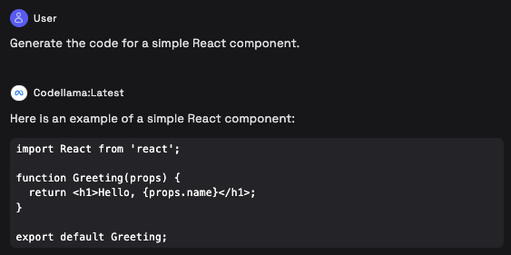
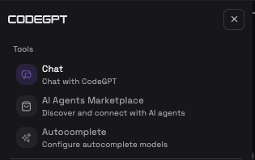
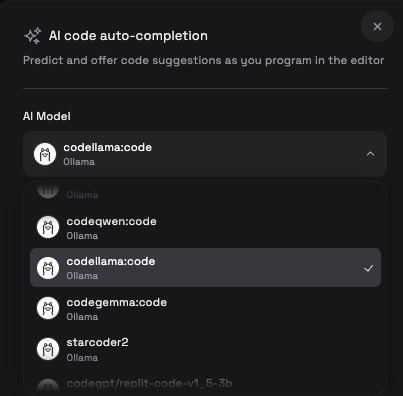
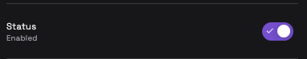
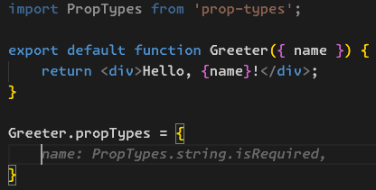
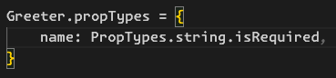

Does your company block ChatGPT or GitHub Copilot? Do you have security or trust concerns sending your code to a third party AI service? You might not know this, but you can run a large language model (LLM) locally on your computer, and even integrate it with Visual Studio Code.

Using the [Ollama](https://ollama.com) tool, you can download and run models locally. In this post, I’ll guide you through the steps to run the Code Llama model using Ollama, and integrate it into Visual Studio Code.

[Code Llama](https://ollama.com/library/codellama) is an LLM from Meta that is focused on generating and talking about code. It’s based on their Llama 2 model, and supports many different languages.

## Installing Ollama and the Code Llama model

Your first step is to install Ollama. Go over to [https://ollama.com](https://ollama.com/download) where you can download and install it. Once Ollama is up and running, you should have a new terminal command, `ollama`. To see if it’s installed correctly, open a terminal and run:

```plaintext
ollama -v
```

This should print the Ollama version. If you see this, then you’re good to go! Next, download the Code Llama model by running this command:

```plaintext
ollama pull codellama
```

This may take a while, depending on your Internet connection. The 7b version of Code Llama is 3.8 gigabytes. Go get a cup of coffee, tea, or your favorite beverage while Ollama downloads this model.

## Setting up CodeGPT

[CodeGPT](https://codegpt.co/) has a Visual Studio Code extension where you can interact with models directly in the editor. In VS Code, go to the Extensions tab and search for “codegpt”. You’ll see several results, make sure to get the one with the blue check mark:



Once CodeGPT is installed, you should see a new CodeGPT icon in the editor’s sidebar. When you click on this, you’ll be taken to the CodeGPT interface. Click the dropdown menu at the top of this panel and select Ollama as the provider, and `codellama` as the model:



Once you’re up and running, you will see a text area at the bottom of this panel to start chatting. Try entering a prompt such as “Generate the code for a simple React component”.

Code Llama will start processing your request. Keep in mind that running a model locally is not as powerful, or fast, as an online service like Meta AI or ChatGPT. After a few seconds, you should have a result in the chat window.



## Setting up completion

You can also use CodeGPT to suggest code completion, like GitHub Copilot and similar tools do. To set this up, in the CodeGPT Chat window, click the Menu button at the top left part of the screen. A menu will slide out with several options.



Select “Autocomplete” to set up code completion.

Code Llama has a `code` variation that you can use for code completion. It is a separate model, so you’ll have to make another large download. Select the `codellama:code` model from the “AI Model” dropdown:



Next, make sure to click the toggle switch to enable completion:



Now, as you type in your editor, Code Llama will make suggestions for you. For example, here it is filling in the `PropTypes` for a `Greeter` component:



If you like a suggestion, you can press the Tab key to accept it:



## Have fun!

That’s really all there is to it. You now have AI chat and code completion integrated in Visual Studio Code!
