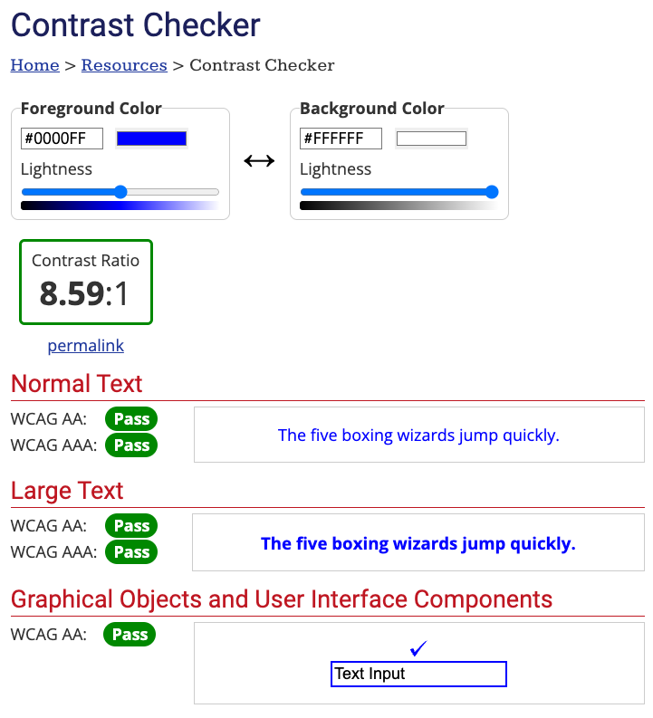
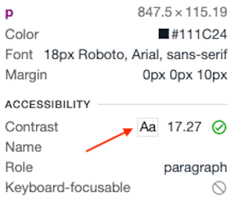

Accessibility is a popular topic these days - as it should be. There are many benefits of making your application accessible - it promotes inclusivity by making your app usable by everyone.

There are many aspects of accessibility that you need to keep in mind, one of which is color contrast. Proper color contrast not only looks good, but it's critical for users with low vision.

Specifically, you need to make sure that there is enough contrast between your background color and text color. If the contrast is too low, the text is not easily distinguishable from the background and it's hard to read. Even for users without disabilities, this is problematic as it can lead to eye strain.

The Web Content Accessibility Guidelines (WCAG) provides some guidance on contrast ratios.

## What is a contrast ratio?

The term "contrast ratio" refers to the difference, or ratio, in brightness between the background and text colors.

The [WCAG guidelines](https://www.w3.org/TR/WCAG21/) formally define the [contrast ratio](https://www.w3.org/TR/WCAG21/#dfn-contrast-ratio) as:

> (L1 + 0.05) / (L2 + 0.05), where
>
> - L1 is the relative luminance of the lighter of the colors, and
>
> - L2 is the relative luminance of the darker of the colors.

## How much contrast is enough?

The contrast ratios required by WCAG differ slightly depending on the size of the text.

### Large text

Large text size is defined as follows:

- For **bold** text, 14 points or larger

- For non-bold text, 18 points or larger

Large text has a more relaxed contrast requirement since larger text is easier to read. For large text, the minimum contrast ratio is 3:1. This minimum is known as Level AA.

There is also a notion of enhanced contrast, known as Level AAA. For large text, AAA requires a minimum ratio of 4.5:1.

### Normal text

Since smaller text is not as easy to read, it has stricter contrast requirements.

For Level AA, text must have a minimum contrast ratio of 4.5:1. The enhanced Level AAA contrast is a minimum of 7:1.

### Non-text elements

Non-text elements, such as icons, have a minimum contrast ratio of 3:1 for Level AA.

Level AAA does not define a minimum contrast for non-text elements.

The following table summarizes the different minimum contrast ratios:

|         | **Large text** | **Normal text** | **Non-text** |
| ------- | -------------- | --------------- | ------------ |
| **AA**  | 3:1            | 4.5:1           | 3:1          |
| **AAA** | 4.5:1          | 7:1             |              |

## Checking contrast

The easiest way to check your color contrast is to use a tool. WebAIM has an excellent [Contrast Checker](https://webaim.org/resources/contrastchecker/). You can enter your foreground and background colors, and it will show you if the contrast meets AA and AAA standards.

The Chrome developer tools will also show the contrast ratio when inspecting an element:

## Visualizing contrast

Here are a few examples of different color contrast ratios. Screenshots are courtesy of the [WebAIM Contrast Checker](https://webaim.org/resources/contrastchecker/).

1.4:1 (does not meet minimum standard):

4.51:1 (meets level AA standard):

7:1 (meets level AAA standard):

## Conclusion

Using sufficient color contrast is good for everyone, but critical for accessibility. Of course, color alone is not enough to make an accessible experience. For other resources to make your UI accessible, check out:

- [WCAG 2 Overview](https://www.w3.org/WAI/standards-guidelines/wcag/) \[w3.org\]

- [WebAIM](https://webaim.org/) \[webaim.org\]
