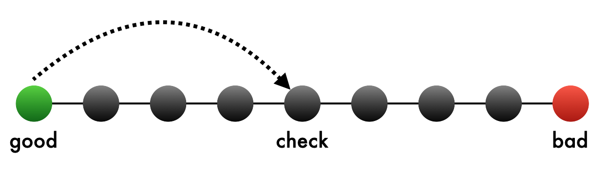
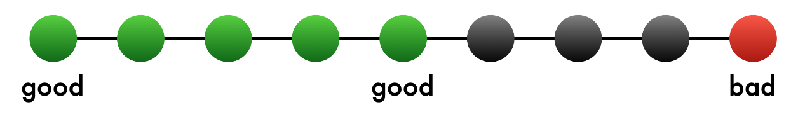
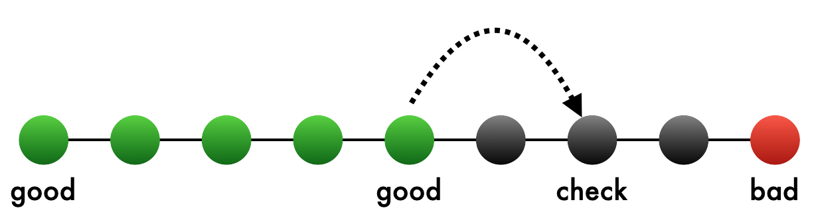
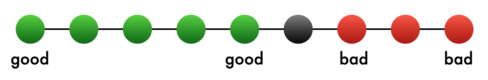
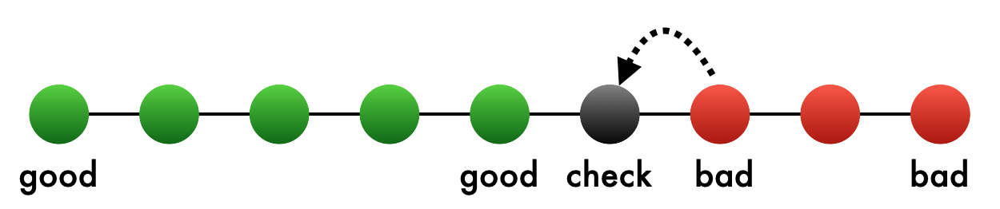
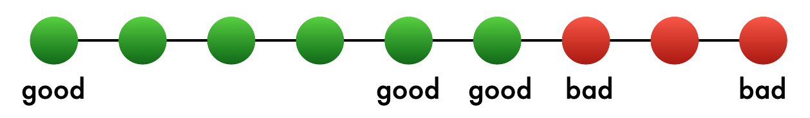
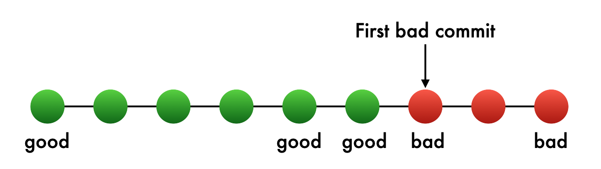

You’re working on a bug fix and find some bad code that causes a bug. The `git blame` command will tell you who the last developer was that modified that line, and when they modified it. But what if you don’t know what code introduced the bug? For these situations, the `git bisect` command can help.

To use `git bisect`, you’ll need to find a commit where the bug exists (a “bad” commit), and you’ll also need to find an older commit where the bug doesn’t exist (a “good” commit).

Once you identify these two commits, `git bisect` will guide you through a binary search of the commit history.

This can save you considerable time if there are a lot of commits between the bad commit and the good commit. At each step of the binary search, you perform a test to see if the bug exists. If the bug exists at this commit, you tell `git bisect` that this is a bad commit. If the bug doesn’t exist, you indicate that it’s a good commit.

Depending on whether the commit is bad or good, `git bisect` picks another middle point between the commit you identified and the bad commit. The process continues until Git has identified the first bad commit which introduced the bug.

## Example bisect

Let’s walk through a short `git bisect` and see a visualization of each step.

First, to start the process, run `git bisect start`:

```plaintext
% git bisect start
status: waiting for both good and bad commits
```

Make sure you’ve checked out a commit or branch that exhibits the bug you’re investigating, and run `git bisect bad`:

```plaintext
% git bisect bad
status: waiting for good commit(s), bad commit known
```

Next, you’ll need to check out a known good commit and run `git bisect good`:

```plaintext
% git checkout <commit ID>
% git bisect good
Bisecting: X revisions left to test after this (roughly Y steps)
```

At this point, you’ve identified a good commit and a bad commit, and Git is pointing to a commit in the middle for you to check.



Run or test your code, and see if the bug exists here. If you can’t reproduce the bug, mark this as a good commit by running `git bisect good`. Now Git knows that the commits between the first good commit and this one are all good:



Now, Git will continue the binary search. It will pick the commit in the middle between the good and bad commits, and check it out for you to check:



Suppose that here, you are able to reproduce the bug. Mark this as a bad commit by running `git bisect bad`. Git will mark this commit as bad:



It will pick the next commit between the good and bad commits, and continue binary searching:



Let’s assume that this is a good commit, and you can’t reproduce the bug. Just as you did before, run `git bisect good` to mark this as a good commit:



At this point, Git has enough information to tell you the first bad commit.



Now you can look at the changes from that commit and, hopefully, determine what change caused the bug.

When you’re done, run `git bisect reset` to exit bisect mode and return to the commit you were at when you started bisecting.

## Mixing up good and bad commits

`git bisect` can only work if the good commit is an ancestor of a bad commit. If you mark a commit as good, then check out an earlier commit and mark it as bad, you’ll get an error:

```plaintext
Some good revs are not ancestors of the bad rev.
git bisect cannot work properly in this case.
Maybe you mistook good and bad revs?
```

## Automating `git bisect`

It might be tedious to manually test your code at each step of a `git bisect`, but you might be able to automate it. You can use `git bisect run` and give it the name of a script or other command to run. Git will check the exit code of the command at each step.

If the exit code is 0, it’s treated as a good commit. If you want the commit to be treated as a bad commit, your command should have an exit code between 1 and 127. However, there is one exception to this. Git reserves the exit code 125 to have a special meaning. If, for some reason, this commit can’t be tested, your command can return an exit code of 125 and it will skip that commit.

## Summary

The `git bisect` command can help you quickly narrow down which commit introduced a bug or other undesirable behavior. It does this by performing a binary search on the commit history between a known good commit and a known bad commit.

If you have automated tests, you can even use `git bisect run` to automatically control the process of testing and identifying good and bad commits.
